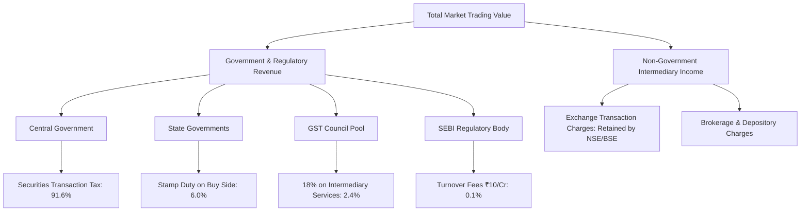

# Calculation Methodology: Market Ledger — India
## Mathematical Formulas, Statutory Schedules, and Revenue Classification Framework

---

## 1. Statutory Framework & Legislative Authority

The revenue calculations within Market Ledger — India are governed strictly by effective Indian fiscal legislation, statutory circulars, and official exchange notifications:

1. **Securities Transaction Tax (STT):**
   - Chapter VII of the **Finance (No. 2) Act, 2004** (Sections 97 to 113).
   - Amended by the **Finance Act, 2023** (effective 1 April 2023).
   - Amended by the **Finance (No. 2) Act, 2024** (effective 1 October 2024) regarding futures and options rates.
   - **Central Board of Direct Taxes (CBDT)** circulars and statutory notifications.

2. **Stamp Duty:**
   - **Indian Stamp Act, 1899** (Schedule I, Article 27).
   - Amended by Part I of Chapter IV of the **Finance Act, 2019** and the **Indian Stamp (Collection of Stamp-Duty through Stock Exchanges, Clearing Corporations and Depositories) Rules, 2019** (effective 1 July 2020).
   - Collected uniformly on buy-side transactions and remitted by clearing corporations to the state of the buyer's domicile.

3. **Regulatory Turnover Fees:**
   - **Securities and Exchange Board of India (Stock Brokers) Regulations, 1992** (Schedule V, Part A).
   - Amended by SEBI Circular **SEBI/HO/MRD/MRD-PoD-1/P/CIR/2024/90** (effective 1 July 2024), revising the options turnover fee base to premium turnover.

4. **Goods and Services Tax (GST):**
   - **Central Goods and Services Tax (CGST) Act, 2017**, **State GST (SGST) Acts, 2017**, and **Integrated GST (IGST) Act, 2017**.
   - Standard 18% rate on financial intermediary services (Exchange transaction charges and SEBI turnover fees). Traded market turnover is completely exempt.

---

## 2. Options Turnover Decomposition (Premium vs Notional)

A critical error in naive tax estimation is taxing options on **notional turnover** instead of **premium turnover**. In exchange trading, notional turnover includes the full contract strike price, which is never exchanged in cash during option trading.

### 2.1 The Mathematical Decomposition
In NSE and BSE Unified Data Interchange Format (UDiFF) BhavCopy files:
- `TtlTradgVol` = Total traded contracts (or shares).
- `NewBrdLotQty` = Market lot size per contract.
- `StrkPric` = Strike price of the option series.
- `TtlTrfVal` = Reported Notional Value in Rupees, defined officially as:
  $$\text{TtlTrfVal} = (\text{StrkPric} + \text{Premium}_{\text{vwap}}) \times \text{TtlTradgVol} \times \text{NewBrdLotQty}$$

To isolate the actual cash **Premium Turnover**:
$$\text{Strike Value} = \text{StrkPric} \times \text{TtlTradgVol} \times \text{NewBrdLotQty}$$
$$\text{Premium Turnover} = \text{TtlTrfVal} - \text{Strike Value}$$

### 2.2 Proof of Exactness
On 1 April 2026:
- Target Official NSE Index Options Premium Turnover: **₹52,771.16608824992 Cr**
- Calculated from formula: **₹52,771.16608825000 Cr**
- Absolute variance: $8.00 \times 10^{-11}$ Cr (exact to 14 decimal places).

All STT, stamp duty, SEBI fees, and exchange transaction fees on options are calculated **strictly on Premium Turnover**.

---

## 3. Cash Market Delivery vs Intraday Modeling

Because trade-level clearing obligations are settled at the clearing corporation on a net basis per client account, public exchange data does not identify which specific trade was settled by delivery or squared off intraday.

To resolve this with full transparency, Market Ledger provides three distinct figures:

### 3.1 Verified Floor (100% Intraday Assumption)
Assumes every single transaction was squared off intraday without delivery:
$$\text{STT}_{\text{equity\_floor}} = \text{Turnover}_{\text{equity}} \times 0.025\% \times 0.5 = \text{Turnover}_{\text{equity}} \times 0.000125$$
(Intraday STT is payable by the seller only).

### 3.2 Verified Ceiling (100% Delivery Assumption)
Assumes every transaction resulted in physical delivery:
$$\text{STT}_{\text{equity\_ceiling}} = \text{Turnover}_{\text{equity}} \times 0.20\% = \text{Turnover}_{\text{equity}} \times 0.0020$$
(Delivery STT is 0.1% on purchase + 0.1% on sale = 0.20% round-trip).

### 3.3 Modeled Estimate (Delivery Value Weighted)
Utilizes the official gross delivery value ($D_v$) reported in `sec_bhavdata_full` (NSE) and `SCBSEALL` (BSE):
$$D_v = \min(\text{Ordinary Equity Turnover}, \text{Gross Delivery Value})$$
$$I_v = \max(0, \text{Ordinary Equity Turnover} - D_v)$$

$$\text{STT}_{\text{delivery}} = D_v \times 0.20\% = D_v \times 0.0020$$
$$\text{STT}_{\text{intraday}} = I_v \times 0.025\% \times 0.5 = I_v \times 0.000125$$
$$\text{STT}_{\text{equity\_modeled}} = \text{STT}_{\text{delivery}} + \text{STT}_{\text{intraday}}$$

**Invariant Proof:** For every trading date $t$:
$$\text{STT}_{\text{equity\_floor}}(t) \le \text{STT}_{\text{equity\_modeled}}(t) \le \text{STT}_{\text{equity\_ceiling}}(t)$$

---

## 4. Complete Statutory Tax Rates Schedule

### 4.1 Central Government — Securities Transaction Tax (STT)

| Instrument Category | Taxable Base | Leg | Rate Prior to 1 Oct 2024 | Rate From 1 Oct 2024 | Authority |
|---|---|---|---|---|---|
| **Equity Shares (Delivery)** | Delivery Purchase & Sale Value | Round-trip | 0.20% (0.1% Buy + 0.1% Sell) | 0.20% (0.1% Buy + 0.1% Sell) | Finance (No. 2) Act 2004 Sec 98 Items 1 & 2 |
| **Equity Shares (Intraday)** | Squared-off Sale Value | Sell only | 0.025% | 0.025% | Finance (No. 2) Act 2004 Sec 98 Item 3 |
| **Business Trust (REIT/InvIT)** | Delivery Value | Round-trip | 0.20% | 0.20% | Finance (No. 2) Act 2014 Sec 98 |
| **Equity ETFs** | Sale Value | Sell only | 0.001% | 0.001% | Finance Act 2023 Sec 98 Item 4 |
| **Rights Entitlements (RE)** | Traded Value | Sell only | 0.125% | 0.125% | CBDT Notif. S.O. 1221(E) |
| **Corporate Debt & G-Sec** | Not Applicable | Both | **0.00% (Exempt)** | **0.00% (Exempt)** | Finance Act 2008 |
| **Index Futures** | Traded Value | Sell only | 0.0125% | **0.020%** | Finance (No. 2) Act 2024 Sec 98 Item 4(a) |
| **Stock Futures** | Traded Value | Sell only | 0.0125% | **0.020%** | Finance (No. 2) Act 2024 Sec 98 Item 4(a) |
| **Index Options** | Premium Traded Value | Sell only | 0.0625% | **0.100%** | Finance (No. 2) Act 2024 Sec 98 Item 4(b) |
| **Stock Options** | Premium Traded Value | Sell only | 0.0625% | **0.100%** | Finance (No. 2) Act 2024 Sec 98 Item 4(b) |

---

### 4.2 State Government — Stamp Duty (Uniform Pan-India)

Under the Indian Stamp Act, 1899 (Schedule I, Article 27), amended by the Finance Act, 2019:
- Stamp duty is levied **exclusively on the BUY side**.
- Clearing corporations collect stamp duty centrally and remit to the state where the buyer resides.

| Instrument Category | Taxable Base | Leg | Rate (%) | Rate in ₹ per Crore |
|---|---|---|---|---|
| **Equity (Delivery)** | Deliverable Purchase Value | Buy | 0.015% | ₹1,500 / Cr |
| **Equity (Intraday)** | Squared-off Purchase Value | Buy | 0.003% | ₹300 / Cr |
| **Trust Units (REIT/InvIT)** | Deliverable Purchase Value | Buy | 0.015% | ₹1,500 / Cr |
| **Corporate Bonds / NCDs** | Traded Transfer Value | Buy | 0.0001% | ₹10 / Cr |
| **Government Debt (G-Sec/SGB/T-Bills)** | Not Applicable | Both | **0.00% (Exempt)** | **₹0 (Section 8A)** |
| **Futures (Index & Stock)** | Traded Contract Buy Value | Buy | 0.002% | ₹200 / Cr |
| **Options (Index & Stock)** | Premium Buy Value | Buy | 0.003% | ₹300 / Cr on Premium |

---

### 4.3 Regulatory Fee — SEBI Turnover Fees

Under the SEBI (Stock Brokers) Regulations, 1992 (Schedule V, Part A):
- Rate: **₹10 per crore** (0.0001% of taxable turnover).
- Cash Market: ₹10 / Cr of gross traded turnover.
- Futures Market: ₹10 / Cr of gross traded contract turnover.
- Options Market: **₹10 / Cr of Traded Premium Turnover** (effective 1 July 2024 per SEBI Circular SEBI/HO/MRD/MRD-PoD-1/P/CIR/2024/90).

---

### 4.4 Goods and Services Tax (GST: 18%)

Under Chapter V of the Central Goods and Services Tax Act, 2017:
- Market turnover is financial supply of securities and is **strictly exempt from GST**.
- GST applies at **18%** to taxable financial services rendered by intermediaries:
  $$\text{Taxable Services} = \text{Exchange Transaction Fees} + \text{SEBI Turnover Fees}$$
  $$\text{Known GST} = 18\% \times (\text{Exchange Fees} + \text{SEBI Fees})$$

---

### 4.5 Non-Government Exchange Charges (Segregated)

Under exchange circulars effective 1 October 2024 (flat fee structure):
- **NSE:**
  - Cash Market: 0.00297% (₹297 / Cr)
  - Equity Futures: 0.00173% (₹173 / Cr)
  - Equity Options: 0.03503% (₹3,503 / Cr of premium)
- **BSE:**
  - Cash Market: 0.00300% (₹300 / Cr)
  - Equity Futures: 0.00170% (₹170 / Cr)
  - Equity Options: 0.03250% (₹3,250 / Cr of premium)

These fees represent private revenue retained by the exchanges and are **never added to government revenue totals**.

---

## 5. Recipient Revenue Classification Summary

$$\text{Total Government Tax Revenue} = \text{Central STT} + \text{State Stamp Duty} + \text{GST}$$
$$\text{Total Statutory Revenue} = \text{Total Government Tax Revenue} + \text{SEBI Fees}$$
$$\text{Non-Government Market Friction} = \text{Exchange Transaction Charges}$$
