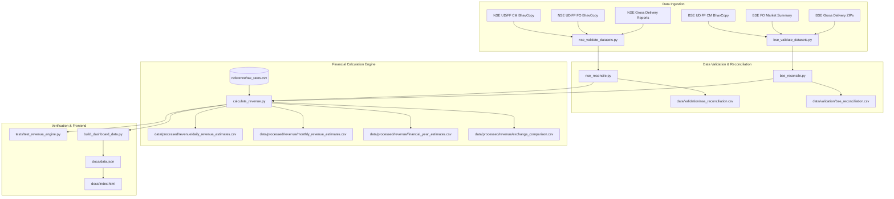

# Market Ledger — India
## Indian Stock-Market Statutory Revenue Estimation Platform

**Market Ledger — India** is an enterprise-grade, deterministic financial data engineering and quantitative analytics platform that estimates the statutory government revenues generated by Indian stock market transactions across the National Stock Exchange (NSE) and Bombay Stock Exchange (BSE).

Tracking daily transaction data beginning **1 April 2026**, the platform ingests, validates, reconciles, and calculates:
1. **Central Government:** Securities Transaction Tax (STT) on deliverable equity, intraday equity, trust units (REITs/InvITs), equity ETFs, index futures, stock futures, and option premiums.
2. **State Governments:** Stamp Duty levied under the Indian Stamp Act, 1899 (Schedule I, Article 27) on buy-side transactions remitted to the state of investor residence.
3. **Goods & Services Tax (GST):** 18% levied strictly on taxable financial services (Exchange Transaction Charges and SEBI Regulatory Fees). Traded market turnover is strictly excluded.
4. **SEBI:** Regulatory Turnover Fees levied under the SEBI (Stock Brokers) Regulations, 1992.
5. **Non-Government Charges:** Exchange transaction fees tracked separately as market friction costs and never mixed into government revenue.

---

## 1. Executive Summary (FY 2026–27 to Date)

Based on 152 verified trading dates (1 April 2026 through 9 November 2026):

| Financial Category | Amount (₹ Crore) | Share of Gov Tax (%) | Legal Citation / Authority |
|---|---|---|---|
| **Total Market Turnover** | **₹54,213,840.37 Cr** | — | Combined cash, futures, and option premium |
| **Central Government (STT)** | **₹38,135.74 Cr** | 91.61% | Finance (No. 2) Act 2004 Chapter VII / Finance Act 2024 |
| **State Governments (Stamp Duty)** | **₹2,502.19 Cr** | 6.01% | Indian Stamp Act 1899 Schedule I Item 27 (Buy side) |
| **GST on Financial Services (18%)** | **₹991.22 Cr** | 2.38% | CGST / SGST / IGST Acts 2017 (Exchange & SEBI fees) |
| **Total Government Tax Collections** | **₹41,629.15 Cr** | **100.00%** | Combined Central + State + GST Tax Receipts |
| **SEBI Regulatory Turnover Fees** | **₹54.21 Cr** | Regulatory Fee | SEBI (Stock Brokers) Regulations 1992 (₹10/Cr) |
| **Total Statutory Revenue** | **₹41,683.36 Cr** | Statutory Total | Taxes + Regulatory Fees |
| **Non-Government Exchange Charges** | **₹5,452.56 Cr** | Private Income | Retained by NSE and BSE as operational income |

*Exchange Distribution:* NSE accounts for **83.0%** (₹34,606.33 Cr) and BSE accounts for **17.0%** (₹7,077.03 Cr) of statutory collections.

---

## 2. System Architecture



---

## 3. Environment & Prerequisites

The platform is designed to run natively on **Windows 11 PowerShell** with zero external compiled C-extension binary dependencies. All data engineering pipelines utilize Python's standard library (`csv`, `Decimal`, `datetime`, `json`, `zipfile`, `unittest`) and `requests`.

### Toolchain Verification
```powershell
# Verify Python
py --version
# or
python --version

# Verify standard requests dependency
python -c "import requests; print('requests is ready')"
```

If dependencies are missing, install via:
```powershell
pip install -r requirements.txt
```

---

## 4. How to Run the Platform

### Option A: Execute the Master Orchestrator (Recommended)
To run end-to-end dataset validation, reconciliation, revenue calculation, unit tests, and dashboard updates in one command:
```powershell
cd D:\bse-tracker\bse-tracker
python run_pipeline.py
```

### Option B: Run Individual Pipeline Stages

1. **Validate and Deduplicate Datasets:**
   ```powershell
   python nse_validate_datasets.py
   python bse_validate_datasets.py
   ```

2. **Execute Turnover Reconciliation Against Official Reports:**
   ```powershell
   python nse_reconcile.py
   python bse_reconcile.py
   ```

3. **Run the Statutory Revenue Calculation Engine:**
   ```powershell
   python calculate_revenue.py
   ```

4. **Execute Automated Unit & Integration Tests:**
   ```powershell
   python -m unittest tests/test_revenue_engine.py
   ```

5. **Rebuild Dashboard Data Payload:**
   ```powershell
   python build_dashboard_data.py
   ```

### Option C: Launch the Dashboard Locally
```powershell
# Run the local server
.\serve.bat
# Open your browser at http://localhost:8000
```

---

## 5. Key Financial Rules & Guardrails

1. **Option Premium vs Notional:** STT and SEBI fees are levied strictly on **traded premium value**, NEVER on notional turnover. Premium turnover is calculated deterministically as:
   $$\text{Premium Turnover} = \text{TtlTrfVal} - (\text{StrkPric} \times \text{TtlTradgVol} \times \text{NewBrdLotQty})$$
2. **Delivery Bounds:** Because client-level clearing obligations are private, public exchange data cannot classify individual trades into intraday or delivery. We report:
   - **Floor:** 100% intraday (0.025% on sell side)
   - **Ceiling:** 100% delivery (0.20% round-trip)
   - **Modeled Estimate:** Delivery-share weighted using official gross delivery files.
3. **Finance (No. 2) Act 2024 Cutoff:** Tax rates dynamically adjust on 1 October 2024 (Futures STT increased from 0.0125% to 0.02%; Options Premium STT increased from 0.0625% to 0.10%).
4. **GST Treatment:** GST (18%) is applied strictly to taxable financial supplies (Exchange transaction fees + SEBI turnover fees). Traded market turnover is completely exempt.
5. **Non-Government Segregation:** Exchange transaction charges (~₹297/Cr cash on NSE, ~₹300/Cr on BSE) are classified as Non-Government intermediary revenue and never added into government tax totals.

---

## 6. Project Documentation Index

- [`PROJECT_AUDIT.md`](file:///D:/bse-tracker/bse-tracker/PROJECT_AUDIT.md) — Complete environment, architecture, and code audit.
- [`CALCULATION_METHODOLOGY.md`](file:///D:/bse-tracker/bse-tracker/CALCULATION_METHODOLOGY.md) — Comprehensive mathematical formulas and statutory tax basis definitions.
- [`DATA_DICTIONARY.md`](file:///D:/bse-tracker/bse-tracker/DATA_DICTIONARY.md) — Complete schema definitions for all 34 UDiFF fields, reference tables, and processed datasets.
- [`DATA_SOURCES.md`](file:///D:/bse-tracker/bse-tracker/DATA_SOURCES.md) — Endpoints, formats, and reconciliation sources for NSE and BSE.
- [`VALIDATION_REPORT.md`](file:///D:/bse-tracker/bse-tracker/VALIDATION_REPORT.md) — Comprehensive reconciliation results and tolerance proofs.
- [`CHANGELOG.md`](file:///D:/bse-tracker/bse-tracker/CHANGELOG.md) — Chronological development history and phase completions.
